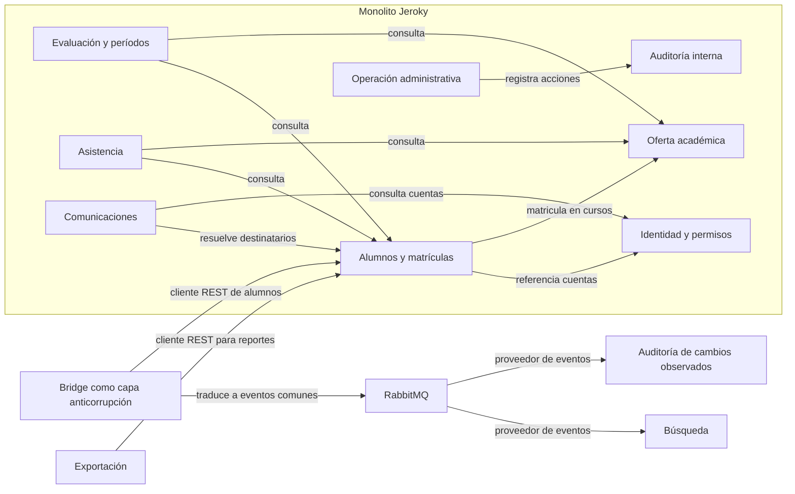

# Mapa de contextos

Mapa de responsabilidades actual. Los límites internos del monolito son contextos de análisis; no son servicios desplegados independientes. Las flechas explican dependencias, no acceso SQL de los microservicios.

Jeroky es proveedor de datos académicos; bridge y exportación son clientes. El bridge funciona como capa anticorrupción al transformar firstName y lastName en name y limitar los campos publicados. Búsqueda y auditoría reciben un contrato publicado independiente del esquema PostgreSQL.

No hay escritura inversa desde las copias hacia Jeroky. No hay transacción distribuida entre monolito, RabbitMQ y consumidores. La outbox del bridge es local al observador y no asegura capturar cada transacción del monolito.
