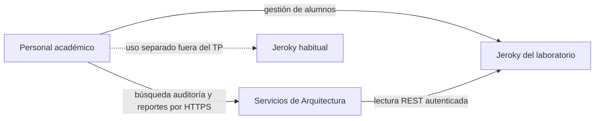
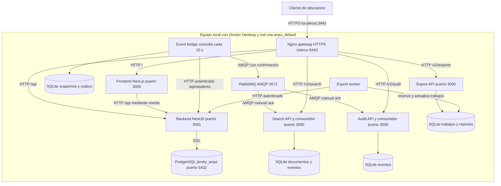
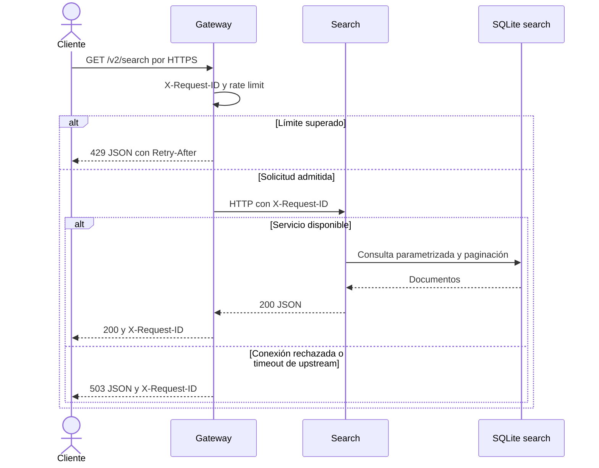

# Arquitectura y secuencias actuales

Estos diagramas describen lo implementado al 16 de noviembre de 2026. No incluyen MinIO, observabilidad o webhooks como si estuvieran desplegados. Los diagramas son fuentes Mermaid para F5-E5, F5-E6 y F5-E7; falta exportar las figuras finales del informe.

## C4 nivel 1 contexto



Jeroky habitual y laboratorio tienen bases y redes separadas. El conjunto del laboratorio se ejecuta en Docker Desktop en un solo equipo; no presentamos esto como un clúster de varias VM.

## C4 nivel 2 contenedores



El puerto HTTP 3180 redirige a 3443. Todavía hay puertos loopback de diagnóstico: frontend 3100, backend 3101, audit 3102, search 3103, export 3104, AMQP 5682 y panel 15682. PostgreSQL no publica puerto. Falta el ajuste de entrega a 443 y la revisión de acceso único exigida por CA-4.

## Secuencia edición e indexación

```mermaid
sequenceDiagram
 actor U as Usuario
 participant J as Jeroky laboratorio
 participant B as Bridge
 participant O as SQLite bridge
 participant Q as RabbitMQ
 participant S as Search
 participant A as Audit
 U->>J: Editar alumno autenticado
 J-->>U: Resultado del cambio
 loop Cada 10 segundos
  B->>J: Login y GET alumnos
  alt Lectura válida
   J-->>B: Lista actual
   B->>O: Transacción snapshots y outbox
   B->>Q: Publicar evento persistente
   alt Broker confirma y no devuelve mensaje sin ruta
    Q-->>B: Confirmación
    B->>O: Borrar pendiente
    Q->>S: Evento updated o deleted
    S->>S: Transacción documento y event_id
    S-->>Q: ACK tras guardar o detectar duplicado
    Q->>A: Mismo evento
    A->>A: Guardar con event_id único
    A-->>Q: ACK tras guardar o detectar duplicado
   else Publicación falla
    B->>O: Mantener pendiente
    Note over B,Q: Proceso sale y política de reinicio intenta recuperarlo
   end
  else API falla o datos inválidos
   Note over B,O: Mantener snapshot anterior y registrar error
  end
 end
 Note over S,A: Evento inválido va a DLQ; fallo de almacenamiento usa reintentos acotados
```

El request_id de polling identifica el lote observado. Todavía no es el mismo identificador de la edición HTTP. No se garantiza la meta menor a 5 s ni captura de cambios intermedios.

## Secuencia búsqueda con error



Un parámetro inválido devuelve 400; una falla interna SQL devuelve 500. Nginx transforma 502, 503 y 504 en su respuesta uniforme 503. El identificador se envía al servicio, pero sus consultas HTTP todavía no lo registran de punta a punta.

## Secuencia exportación con error

```mermaid
sequenceDiagram
 actor U as Cliente
 participant G as Gateway
 participant E as Export API
 participant D as SQLite jobs
 participant W as Worker
 participant J as Jeroky
 U->>G: POST /v2/exports
 G->>E: Pedido Markdown
 E->>D: Insertar queued
 E-->>U: 202 job_id mediante gateway
 W->>D: Reservar trabajo con lease de 120 s
 W->>J: Login y consulta alumnos
 alt Consulta y generación correctas
  J-->>W: Datos
  W->>D: Guardar Markdown y completed si conserva lease
 else Falla de consulta o generación
  W->>D: failed con error genérico
 end
 U->>G: GET estado
 G->>E: Consultar job
 E-->>U: 200 con estado mediante gateway
 U->>G: GET download
 G->>E: Descargar
 alt Estado completed
  E-->>U: 200 Markdown mediante gateway
 else Estado pendiente o fallido
  E-->>U: 409 mediante gateway
 end
 Note over W,D: Si el worker muere, otro puede reclamar al vencer lease; falta prueba de interrupción
```

Un job inexistente devuelve 404. Se usa completed en lugar de done y se descarga directamente. Todavía no hay MinIO, URL prefirmada ni eventos export.requested/export.completed.
